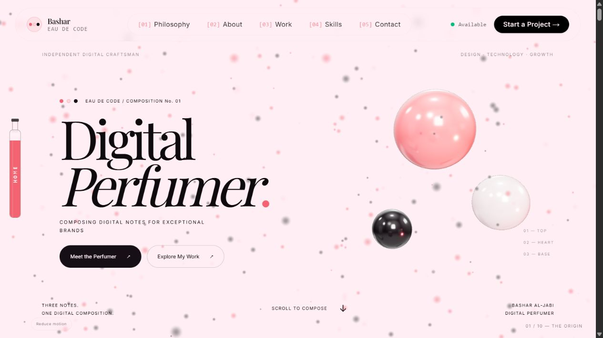

# Fragrance continuum — review draft

Based directly on `main` at `dd1b4f9cbf6a7a9653f0b5e1ad4f21557e41d6f8`. No experimental branch was merged or used as the implementation base. The proposed work is in Draft PR #8 and must remain unmerged.

## Art direction and implementation

A persistent Three.js scene connects the ten original chapters. The original pastel particle Hero and loading animation remain in place. The same three note surfaces reshape into the Philosophy cards; their vertex topology is retained throughout the transition. Absolute scroll keyframes keep the choreography reversible and make anchors, touch scrolling and reverse scrolling agree.

The atmosphere darkens into a glass fragrance laboratory. Notes enter the Formula bottle, continue as rose, pearl and dark liquid ribbons, and form four achievement rings. The real projects appear in a glass gallery with scroll progression, direct project selection, category buttons and previous/next controls. The notes disperse into a seeded star field, reassemble at the skill cabinet, become the Contact frame and settle into the footer's three-dot signature.

The ribbons are procedural 3D surfaces, rather than a fluid dynamics simulation. Their form, ring formation and Contact frame are driven by scroll; low-amplitude surface motion continues during the held compositions. The gallery is a readable HTML/image composition with CSS perspective inside the persistent 3D environment.

No new runtime dependencies were added. Original imports of the transitive `framer-motion` package use the already-declared `motion/react` entry point. The world renders at approximately 30fps with capped pixel ratio; the original Hero canvas is unmounted when outside its chapter. Rendering suspends when the document is hidden. These are implementation limits, not a measured device-performance guarantee.

## Preservation contract

`tests/original-content.json` records the original main revision, complete data records and asset hashes. The automated checks cover:

- All 15 real project records, including descriptions, categories, technology tags, images and destination URLs.
- All 34 skills across the five original groups, with their descriptions and highlights.
- The three Philosophy and Formula records and four original statistics.
- Every original project image, the CV, and the unchanged LoadingScreen, HeroCanvas and Footer sources (normalizing source line endings).
- The existing Formspree form ID `mnpqzbbe`, fields, submission handler, success state and submitting state.
- Original section order and unique anchors.
- Sphere/card bounds, finite interpolation, continuity and deterministic reverse scrolling.

## Validation performed

`npm test` — 6 passing tests. `npm run typecheck` — passes. `npm run build` — passes, with original Google fonts fetched. `git diff --check` — passes.

Visual and interactive inspection used the Codex in-app browser, including the production build. Viewports inspected: 1280×720, 390×844 and 360×740. Inspection covered the original loading sequence, Hero, sphere-to-card sequence, bright-to-dark Formula transition, About sculpture, ring formation, real project gallery, Scent Memory statements and stars, all five skill selectors, and the Contact form. All nine professional project selectors and all six personal project selectors were exercised across the review passes. Mobile navigation, category switching and direct project controls were exercised. The inspected mobile layouts had no horizontal document overflow.

The reduced-motion control was exercised in the production build: the 3D canvas is removed, all 15 projects and five skill groups become readable in document flow, and scroll pinning is removed. The system media query uses the same setup path. A real OS preference change was not separately emulated. The no-JavaScript and WebGL-context-loss alternatives are implemented, but those failure modes were not separately forced in the browser.

Contact service selection and native required-field validation were exercised. Empty submission focuses the required Name field and displays the browser's validation message. The production Formspree endpoint and handler remain unchanged; no valid message was sent to the live inbox, and email delivery is therefore unverified.

The final composition pass moves the Skills notes clear of its introductory text, softens the Philosophy surface reflections, and holds the dark Contact atmosphere until the form has left the viewport. Footer notes land at the measured signature dot positions.

## Scope of this draft

This is a coherent first art-direction pass across all ten chapters. It remains a review draft. Physical iOS/Android devices, Safari, Firefox, GPU context loss, network failure during form submission, live email delivery and a measured performance/accessibility audit remain outside the completed test scope. The visual quality should be assessed in the running preview; a passing build alone does not establish that the full creative brief has been achieved.

